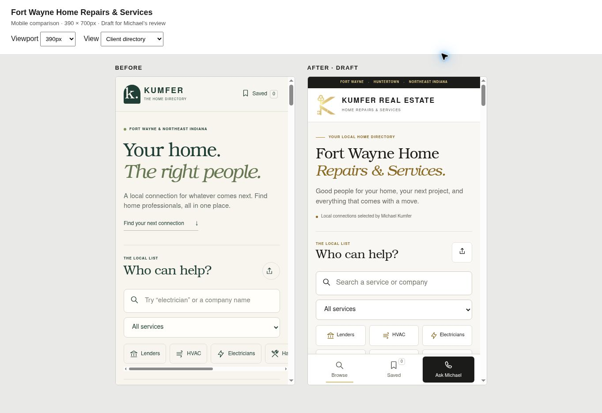
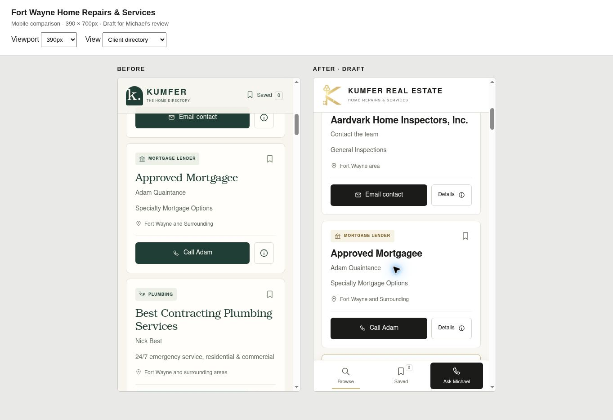
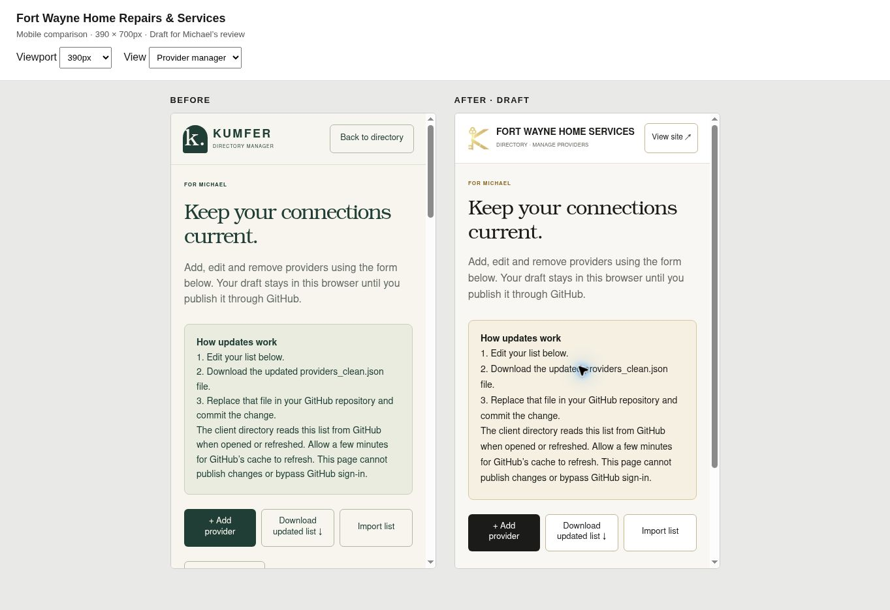

# Fort Wayne directory design review

Prepared November 4, 2026. This branch is a draft for Michael's rough review; it has not been merged or published.

The refresh uses the supplied Kumfer gold key and eXp Realty logos, a black/white/gold palette, editorial serif headlines, and bold, readable provider names. The public heading is **Fort Wayne Home Repairs & Services**. Public metadata now includes a descriptive local title, description, canonical URL, sharing metadata, and CollectionPage structured data. The owner editor remains excluded from search indexing.

On phones, popular categories form a three-column grid and Browse, Saved, and Ask Michael remain accessible in a bottom navigation bar. Provider cards have larger contact actions and a clearly labeled Details button. The owner editor uses the same branding and retains its existing workflow.

## Phone comparisons

Both sides use the same current 27-provider list. Screenshots show 390 × 700px content viewports: the previous site on the left, the draft on the right.

## Validation

- `node scripts/check.mjs` passes: 27 providers, unique contact links, assets, JavaScript syntax, contact safeguards, category rules, live-list precedence, fallback notices, and the manager's stale-data safeguard.
- `providers_clean.json`, `config.json`, `data.js`, and `editor.js` are byte-for-byte unchanged from main commit `d3f53467758239c88b9f1054805d142d520fcee2`.
- Provider data SHA-256: `af465509aa6d4ed385ccafdb8abab582a4a28a7f0d2406a8a615d51fe85f15f7`.
- Browser checks at 320, 375, 390, 430, 768, and 1280px: no horizontal overflow in the client directory. Owner editor also fits 320 and 390px.
- Main navigation, category filters, and contact actions meet a 44px minimum touch height.
- Browser interactions checked: search, category filtering, sorting, saving and unsaving, contact details, call links, vCard control, and opening/canceling the provider editor. No provider changes were saved.
- Public metadata parses correctly; unique HTML IDs and a single H1 per page verified. Desktop composition visually reviewed. No app-origin console errors observed during desktop review.

## Release gate

Await Michael's rough review. After approval, merge this branch into `main`; the existing GitHub Pages workflow publishes `dist`. Verify the workflow succeeds and the public site reflects the approved design. No workflow, DNS, redirect, domain, or hosting changes are included.

SEO metadata helps describe the page to search engines; it does not guarantee a particular ranking. The canonical URL remains the verified GitHub Pages destination. The user's completed custom-link configuration is outside this change.
